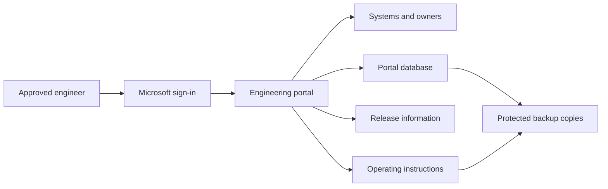

# Backstage Developer Portal on Azure

**Give engineers one place to find systems, their owners, operating instructions and release information.**

[Business problem](#the-business-problem) · [Solution](#the-solution) · [Engineering strengths](#engineering-strengths) · [What was built](#what-was-built) · [Proof it works](#proof-it-works) · [Commands](docs/COMMANDS.md) · [Step by step](#step-by-step)


## The Business Problem

Operating the platform involves more than its employee-facing website. Engineers also need to understand background workers, storage, integrations, deployment records and recovery procedures. When that information is spread across repository folders and operating notes, answering a basic question such as who owns a service can require several searches.

That becomes more costly during an incident or handoff: the operator needs the correct instructions and release evidence while the affected service may already be unavailable. Outdated or hard-to-find guidance can lead to a wrong recovery step. The engineering portal itself also holds operational information and needs protected access and a recoverable configuration.

The business need was one engineering entry point connecting services to their owners, handbook pages and release records, with its own access and recovery boundaries.

## The Solution

I built an internal engineering portal using Backstage. It brings together a service directory, an engineering handbook and release information. Approved engineers sign in through Microsoft.

**Business outcome:** Engineers can move from a system's name to its owner, instructions and release records in one place. The portal runs separately from the employee application and has its own backup and access controls.

## Tools Used and What They Do

| Tool or service | What it does | Where it fits |
| --- | --- | --- |
| Backstage and TechDocs | Provide the service catalog and engineering handbook. | Actual engineering portal; the Python preview is a separate offline example. |
| Docker Compose | Run the portal and its supporting services together. | Actual VM stack definition, not started by the local viewer. |
| Caddy | Serve HTTPS at the front of the portal. | Actual ingress service. |
| OAuth2 Proxy and Microsoft Entra ID | Check ingress sign-in and map the engineer to an approved identity. | Ingress and Backstage identity checks are separate layers. |
| PostgreSQL | Keep portal/plugin data on persistent storage. | Actual portal database; distinct from the business application’s Azure SQL. |
| GitHub Apps | Read approved catalog/release sources and keep proposal-writing authority separate. | Actual scoped integrations; repository read access is not repository write access. |
| Yarn and Corepack | Select the package manager used when building Backstage. | Build-time utilities; not authentication controls. |
| pg_dumpall, gzip and SHA-256 utilities | Create the database dump, compress it and record a file fingerprint. | Actual backup helpers; the saved inventory adds a separate comparison. |
| AzCopy | Upload protected backup material using managed identity. | Operational utility; no backup upload occurs in the offline preview. |

Terraform describes selected host/network boundaries. GitHub Actions supports build and verification processes, while the public manual-only workflow runs reference checks rather than operating the live portal.

## Step by Step

A short walkthrough of the process, with technical instructions and evidence limits in the sections below.

1. **Sign in to the portal (Entra and OAuth2 Proxy)** — An approved engineer signs in through Microsoft. The portal separately checks which actions that person may perform.

2. **Find the system and its owner (Backstage and TechDocs)** — The service directory connects each system to its responsible team and related services. The engineer can then open its operating instructions.

3. **Review release information** — The portal compares release records with a recent observation of what is running. Missing, conflicting or old information stays visibly uncertain.

4. **Protect the portal itself (Backup helpers and AzCopy)** — The operating process saves and checks backups before ending an engineering session. A separate restore test checks whether the required records and settings can be recovered.

## Engineering Strengths

| Capability | Why it matters | Details |
| --- | --- | --- |
| A directory of systems and owners | Helps engineers find the responsible team and related services. | [Service directory](catalog/) |
| Instructions beside each service | Makes operating guidance easier to find. | [Handbook](docs/CATALOG-AND-TECHDOCS.md) |
| Separate access checks | Distinguishes signing in from permission to read or change something. | [Access guide](docs/IDENTITY.md) |
| Honest release status | Shows when records are missing, conflicting or too old to trust. | [Release guide](docs/RELEASE-EVIDENCE.md) |
| Checked backups | Supports recovery beyond merely uploading a backup file. | [Recovery guide](docs/RECOVERY.md) |
| Planned operating sessions | Keeps occasional engineering use separate from an always-running service. | [Operations](docs/OPERATIONS.md) |

### Actual implementation and public reference

The repository includes selected implementation code and a small local demonstration. The demonstration is not the full Backstage application; its example systems and release records are fictional.

## Architecture



The deployed design uses one virtual server. A server failure can interrupt the portal, so backup and recovery remain important.

## What Was Built

- A directory connecting systems to their owners and dependencies.
- A handbook published separately from the portal that displays it.
- Microsoft sign-in and application permission checks.
- Release checks that compare the intended version with current deployment records.
- Startup checks, database backups and tools for testing recovery.
- Related Azure setup code and operating instructions.

[Technical design](docs/ARCHITECTURE.md) and [source records](docs/SOURCE-MAP.md) explain the included implementation.

## Proof It Works

Recorded checks included **nine release-status tests**, **ten startup tests on Linux**, **five directory checks** and **two infrastructure cases using simulated Azure responses**.

The local viewer displayed 16 service-directory entries and all four release states: Verified, Unknown, Conflict and Stale. Its navigation and mobile layout were also checked.

These results concern the included examples and selected code. They are separate from a new live sign-in, deployment or recovery rehearsal. [Full validation record](docs/VALIDATION.md).

<details>
<summary>For engineers: detailed results, examples and commands</summary>

### 1. Refuse incomplete or conflicting release evidence

```bash
python -B -m unittest discover -s reference/releases -v
python -B scripts/demo.py
```

**Look for:** nine original evaluator tests pass; the demonstration produces Verified, Unknown, Conflict and Stale for four fictional scenarios. A successful Actions run or historical pin alone never establishes a current deployment.


### 2. Check startup and network boundaries

```bash
python -B -m unittest discover -s runtime/vm -v
python -B runtime/vm/check-compose.py
```

Run the protected-file tests on Linux; they are skipped on Windows because its file-permission rules differ. The Compose checks read the settings without starting containers or downloading images. The ten original startup tests and the Compose checks cover exact image versions, separate sign-in apps, protected files, the private database connection and the optional separate publishing key.

### 3. Validate the public catalog and selected infrastructure

```bash
python -B -m unittest discover -s tests -v
terraform -chdir=infra init -backend=false -input=false
terraform -chdir=infra validate
terraform -chdir=infra test
```

**Look for:** every catalog Location target exists, component ownership and unique references are present, and the mock Terraform tests preserve default-Off infrastructure and the selected VM constraints. No Azure plan/apply occurs.

### 4. Open the offline reference

```bash
python -B scripts/preview.py
```

Open [the local reference viewer](http://127.0.0.1:8136). Switch between Service catalog, Release evidence and Operating model. Ctrl+C stops it. The screenshots are genuine local captures of this reference, not screenshots of the live Backstage portal. [Validation and scope](docs/VALIDATION.md).

</details>

## Release and Recovery Process

1. Build and test the chosen version.
2. Check its software security findings and use that exact version for release.
3. Check the server settings before starting the portal.
4. Confirm approved sign-in, service listings, handbook access and database health.
5. Save and verify backups, and test restoration separately.
6. End the engineering session and release the server's compute allocation.

[Deployment steps](docs/DEPLOYMENT.md) and [recovery steps](docs/RECOVERY.md) provide the technical instructions.

## Security and Operational Boundaries

Signing in does not automatically grant permission to change services or publish software. The service directory also describes ownership; it does not itself grant access.

The local demonstration does not connect to the employee database or run a production deployment. Restoring the portal requires its configuration and protected credentials as well as the database backup.

## Scaling, Costs and Tradeoffs

One server is straightforward to operate for occasional engineering sessions, but it does not provide continuous availability during a server failure. Backups also require brief pauses to database writes.

Releasing the server's compute allocation stops that compute charge. Retained disks, addresses and storage can still cost money. For sustained use, measure response times and the number of engineers before considering more servers or managed database services. [Growth options](docs/SCALING.md).

## Troubleshooting Lessons

A successful backup command could intentionally skip a stopped session. Fresh backup evidence, database readiness and completed guest-script phases needed separate verification. [Read the incident, evidence and verification](docs/LESSONS-LEARNED.md).

## Project Guides

| Guide | What it explains |
| --- | --- |
| [Engineering strengths](docs/ENGINEERING-STRENGTHS.md) | Practical value and evidence behind the main design choices |
| [Architecture](docs/ARCHITECTURE.md) | Portal, business application and infrastructure boundaries |
| [Identity and permissions](docs/IDENTITY.md) | Two Entra layers, engineer policy and separate writer |
| [Catalog and TechDocs](docs/CATALOG-AND-TECHDOCS.md) | Ownership, publication and read-only serving |
| [Release evidence](docs/RELEASE-EVIDENCE.md) | Verified, Unknown, Conflict and Stale |
| [Deployment](docs/DEPLOYMENT.md) | Build, digest, host readiness check and rollback |
| [Backup and recovery](docs/RECOVERY.md) | Database, handbook and separately protected secrets |
| [Operations](docs/OPERATIONS.md) | Session lifecycle, troubleshooting and ClickOps |
| [Commands](docs/COMMANDS.md) | Local checks and controlled-host command examples |
| [Source map](docs/SOURCE-MAP.md) | Actual files and public adaptations |
| [Validation](docs/VALIDATION.md) | Observed local results and untested boundaries |
| [Terraform](infra/README.md) | Selected VM/backup reference and disabled defaults |
| [Scaling](docs/SCALING.md) | Strengths, weaknesses, growth and costs |

This repository has a manual-only validation workflow and no deployment credentials. Creating the portfolio did not start an Azure VM, change employee systems or consume hosted Actions minutes.
