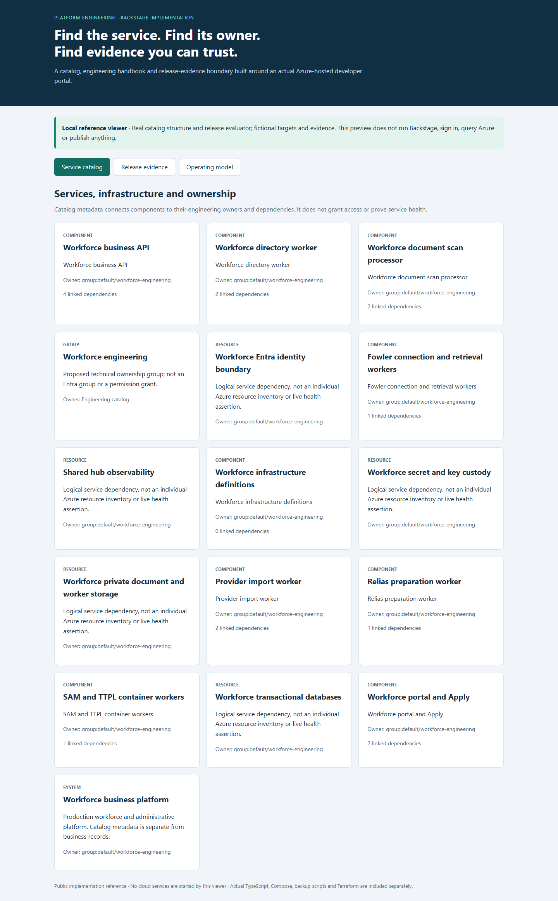
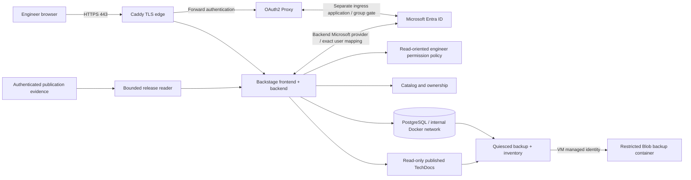
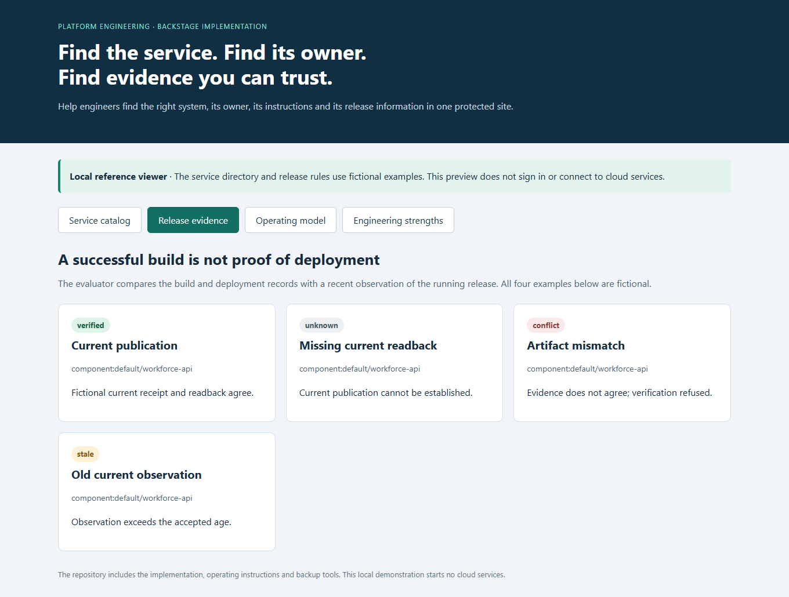

# Backstage Developer Portal on Azure

**Give engineers one place to find the system, its owner and the instructions for running it.**

[Business problem](#the-business-problem) · [Solution](#the-solution) · [What was built](#what-was-built) · [Proof it works](#proof-it-works) · [Commands](docs/COMMANDS.md)



## The Business Problem

As the platform grew, information about applications, background jobs, storage and recovery was spread across different places. Engineers needed a clear way to find who owned each part, how it worked and which version was running. The engineering portal also needed protected access and reliable backups.

## The Solution

Use Backstage to bring the service list, engineering handbook and release information together. Run the portal separately from the employee application, restrict engineer access with Microsoft sign-in, and save its database and handbook outside the server.

**Business outcome:** Engineers can find the right owner and instructions, check release information, and recover the portal without confusing it with the employee application.

### Actual implementation and public reference

This project includes the platform’s service list, startup and permission checks, Microsoft sign-in settings, container settings, backup tools, release checks and related Terraform. Identifying names, domains and target IDs use consistent examples. [Source mapping](docs/SOURCE-MAP.md).

The local preview is a small new reference viewer, **not the Backstage application**. It reads the actual catalog structure and runs the actual Python release evaluator on fictional evidence. It requires no cloud credentials, login or provider call. Full private application dependencies, engineer rosters and secrets are deliberately outside this public example.

## Architecture



Only the edge publishes port 443. PostgreSQL has no host port; Backstage and the proxy are reached through Docker networks. The chosen backup path uses a Storage service endpoint plus default-deny network rules and identity authorization. **It is not a deployed private endpoint.**

The source also describes disabled managed-service alternatives. They are not the running VM architecture and are not commissioned by this repository. [Architecture and boundaries](docs/ARCHITECTURE.md).

## What Was Built

| Component | Purpose | Actual source |
| --- | --- | --- |
| Software catalog | Model services, resources, owners and dependencies | [Entities](catalog/) |
| Backend startup boundary | Confirm whether the portal will run locally or in Azure, and require the matching settings | [Startup](reference/backend/index.ts) |
| Engineering permissions | Allow approved engineers to read; require explicit permission for changes and template actions | [Policy](reference/backend/permissionPolicy.ts) |
| Entra sign-in | Separate ingress and backend applications; map backend identity to catalog user annotation | [Configuration](reference/config/app-config.production.yaml) |
| Four-service VM runtime | Edge, identity proxy, portal and private PostgreSQL network | [Compose](runtime/vm/compose.yaml) |
| Safe startup checks | Reject mutable images, shared identity apps and exposed/missing secret files | [Preflight](runtime/vm/preflight.py) |
| Release evaluator | Check that the release report, source version, saved file and current hosted version agree | [Evaluator](reference/releases/evaluate.py) |
| Recoverable portal state | Tools to save a database backup, check its contents and practise restoring it separately | [Backup](runtime/vm/backup-postgres.sh) · [Restore](runtime/vm/check-restore.sh) |
| Published handbook backup | Archive one saved publication tied to one exact version and verify downloaded file hashes | [TechDocs backup](runtime/vm/backup-techdocs.sh) |
| VM infrastructure | Server access by key, HTTPS network rules, scheduled shutdown, limited image downloads and an optional backup location | [Terraform](infra/) |

## Proof It Works

### 1. Refuse incomplete or conflicting release evidence

```bash
python -B -m unittest discover -s reference/releases -v
python -B scripts/demo.py
```

**Look for:** nine original evaluator tests pass; the demonstration produces Verified, Unknown, Conflict and Stale for four fictional scenarios. A successful Actions run or historical pin alone never establishes a current deployment.



### 2. Check startup and network boundaries

```bash
python -B -m unittest discover -s runtime/vm -v
python -B runtime/vm/check-compose.py
```

Run the protected-file tests on Linux; they are skipped on Windows because its file-permission rules differ. The Compose checks read the settings without starting containers or downloading images. The ten original startup tests and the Compose checks cover exact image versions, separate sign-in apps, protected files, the private database connection and the optional separate publishing key.

### 3. Validate the public catalog and selected infrastructure

```bash
python -B -m unittest discover -s tests -v
terraform -chdir=infra init -backend=false -input=false
terraform -chdir=infra validate
terraform -chdir=infra test
```

**Look for:** every catalog Location target exists, component ownership and unique references are present, and the mock Terraform tests preserve default-Off infrastructure and the selected VM constraints. No Azure plan/apply occurs.

### 4. Open the offline reference

```bash
python -B scripts/preview.py
```

Open [the local reference viewer](http://127.0.0.1:8136). Switch between Service catalog, Release evidence and Operating model. Ctrl+C stops it. The screenshots are genuine local captures of this reference, not screenshots of the live Backstage portal. [Validation and scope](docs/VALIDATION.md).

## Release and Recovery Process

1. Build and test the selected complete Backstage workspace with its locked Node/Yarn/native-module combination.
2. Scan the selected image and promote its exact registry digest; do not equate source HEAD with the deployed image.
3. Prepare protected host inputs separately. Preflight the runtime before starting the stack.
4. Verify trusted HTTPS, allowed engineer sign-in, denied nonmember access, catalog, handbook and database health.
5. Back up plugin databases and handbook publications, verify off-host bytes and rehearse restoration separately.
6. Stop the session and deallocate the VM; keep retained disk/IP/storage costs visible.

The Dockerfile here is an actual build recipe excerpt. It expects full-workspace skeleton/bundle archives and the lockfile that this public subset does not contain. No new image build or live upgrade is claimed. [Deployment detail](docs/DEPLOYMENT.md).

## Security and Operational Boundaries

- Entra ingress admission, backend matching the signed-in person to a known account, permission checks and Azure workload identity are different controls.
- A catalog ownership group is metadata, not an Entra membership or access grant.
- Compose secrets mount protected host files; this does not itself make them Key Vault-backed.
- The optional template writer uses a separate identity/key and approved actions; it is Off in the default profile. Catalog reads do not require a general repository writer.
- The portal is not the business API, employee database, SIEM or an automatic production deployer.
- A completed backup upload is not sufficient recovery proof. Preserve credentials/TLS state through a separate protected recovery process.

## Scaling, Costs and Tradeoffs

The single VM lowers the operating footprint for intentional engineering sessions but is a single group of components that can fail together, with brief backend pauses for consistent backups. Deallocation stops compute billing, not disk, static IP, registry or backup storage charges. A shutdown schedule is a safety net, not a spending cap.

Scale from measured catalog/search latency, documentation access, database growth and concurrent engineers. Managed PostgreSQL, external private TechDocs storage, multiple backend instances and shared sessions require coordinated networking, identity and recovery work; they are not live features of this reference. [Scaling and tradeoffs](docs/SCALING.md).

## Project Guides

| Guide | What it explains |
| --- | --- |
| [Architecture](docs/ARCHITECTURE.md) | Portal, business application and infrastructure boundaries |
| [Identity and permissions](docs/IDENTITY.md) | Two Entra layers, engineer policy and separate writer |
| [Catalog and TechDocs](docs/CATALOG-AND-TECHDOCS.md) | Ownership, publication and read-only serving |
| [Release evidence](docs/RELEASE-EVIDENCE.md) | Verified, Unknown, Conflict and Stale |
| [Deployment](docs/DEPLOYMENT.md) | Build, digest, host readiness check and rollback |
| [Backup and recovery](docs/RECOVERY.md) | Database, handbook and separately protected secrets |
| [Operations](docs/OPERATIONS.md) | Session lifecycle, troubleshooting and ClickOps |
| [Commands](docs/COMMANDS.md) | Local checks and controlled-host command examples |
| [Source map](docs/SOURCE-MAP.md) | Actual files and public adaptations |
| [Validation](docs/VALIDATION.md) | Observed local results and untested boundaries |
| [Terraform](infra/README.md) | Selected VM/backup reference and disabled defaults |
| [Scaling](docs/SCALING.md) | Strengths, weaknesses, growth and costs |

This repository has a manual-only validation workflow and no deployment credentials. Creating the portfolio did not start an Azure VM, change employee systems or consume hosted Actions minutes.
